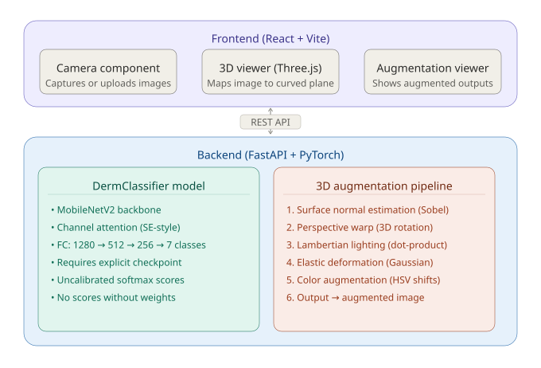

# DermScreen

DermScreen is an educational computer-vision project built around a 3D-aware image augmentation pipeline, a browser camera and upload interface, and a trainable MobileNetV2 classifier.

**This is not a medical device. It has not been clinically validated, and no trained classifier weights ship with it.** By default, classification is disabled. You can still capture or upload images, explore the augmentation steps, and project an image onto a simulated 3D surface. Do not use this project to assess medical risk, diagnose conditions, or make treatment decisions.

## What you can explore

- **Augmentation pipeline:** gradient-based pseudo-surface normals, perspective warping with a 3D rotation and projection, Lambertian lighting, elastic deformation, and HSV color shifts. Each intermediate image is displayed separately.
- **Camera interface:** capture images in the browser or choose an existing image file.
- **3D viewer:** rotate and zoom a curved mesh textured with your image. The geometry and estimated normals are illustrative, not a reconstruction of skin anatomy.
- **Classifier:** experiment with a seven-class MobileNetV2 model with channel attention, trained on your own labeled dataset.



## Local setup

Requirements: Python 3.10–3.13 (tested locally with Python 3.11.16) and Node.js 22.13+ within the 22 series, or Node.js 24+ with npm. CI is configured to test the backend on all four Python versions.

Run the following from the repository root (substitute your supported Python interpreter if needed):

```bash
python3.11 -m venv .venv
source .venv/bin/activate
```

On Linux, if you only need CPU PyTorch, optionally install its CPU builds first:

```bash
python -m pip install torch==2.8.0 torchvision==0.23.0 --index-url https://download.pytorch.org/whl/cpu
```

Then install the project dependencies:

```bash
python -m pip install -r backend/requirements.txt
npm ci --prefix frontend
```

Start the backend and frontend in separate terminals, each from the repository root:

```bash
# Terminal 1
.venv/bin/python -m uvicorn main:app --app-dir backend --host 127.0.0.1 --port 8000
```

```bash
# Terminal 2
npm --prefix frontend run dev
```

Open http://127.0.0.1:5173. Capture or upload an image, then try **View 3D Augmentation** or **3D Surface**. With no weights configured, the Results panel explains that no trained model is loaded. No ImageNet download is needed to run the demo.

The development proxy forwards `/api` to `127.0.0.1:8000`. The backend binds to loopback by default. CORS allows the Vite development origins on port 5173 (`localhost` and `127.0.0.1`); both image endpoints also reject requests with any other `Origin` header before reading the upload. Requests without an `Origin` header remain supported for local command-line use. This origin check is not authentication. Both image endpoints enforce a 10 MiB file limit, reject invalid image content, and limit decoded images to 25 megapixels. The multipart request limit also allows up to 64 KiB of overhead. Use non-sensitive images in this educational demo.

## Train your own classifier

The training script expects a labeled dataset in torchvision ImageFolder format. To use HAM10000, obtain the images and metadata yourself from [Harvard Dataverse](https://doi.org/10.7910/DVN/DBW86T), subject to the dataset's own license and terms. The images and metadata are not included here.

Prepare separate training and validation splits **before** copying images into class directories. For HAM10000, group by `lesion_id` so multiple images of the same lesion never appear in both splits. Keep all seven classes represented in both splits. Map the metadata `dx` codes to the exact model folder names below (the existing model names are shorthand; for example, `akiec` also includes intraepithelial carcinoma):

| HAM10000 code | Directory name |
| --- | --- |
| `akiec` | `Actinic Keratosis` |
| `bcc` | `Basal Cell Carcinoma` |
| `bkl` | `Benign Keratosis` |
| `df` | `Dermatofibroma` |
| `mel` | `Melanoma` |
| `nv` | `Melanocytic Nevi` |
| `vasc` | `Vascular Lesion` |

For example, place your prepared dataset under `data/processed/ham10000/` (ignored by Git):

```text
data/processed/ham10000/
  train/
    Actinic Keratosis/
      image1.jpg
    Basal Cell Carcinoma/
    Benign Keratosis/
    Dermatofibroma/
    Melanoma/
    Melanocytic Nevi/
    Vascular Lesion/
  val/
    (same seven class directories, with different images)
```

Each directory must contain at least one image. The loader maps directory names to the classifier's fixed output order.

Run training from the repository root:

```bash
.venv/bin/python backend/train.py --data-dir data/processed/ham10000 \
  --output weights/dermclassifier.pt --epochs 5 --batch-size 16
```

By default the training script fine-tunes an ImageNet-initialized backbone, which downloads weights if they are not already cached. Use `--no-pretrained` to start from scratch with no download. The script uses cross-entropy, AdamW and 224×224 RGB inputs. It reports validation accuracy (fraction of correctly classified images), balanced accuracy (mean class recall), and recall for each of the seven classes after every epoch. The final state dictionary is saved to the output path.

Restart the backend with your checkpoint explicitly selected:

```bash
DERMSCREEN_WEIGHTS="$PWD/weights/dermclassifier.pt" \
  .venv/bin/python -m uvicorn main:app --app-dir backend --host 127.0.0.1 --port 8000
```

An invalid, non-finite, or missing configured checkpoint fails startup rather than falling back to random predictions. Non-finite inference scores are rejected. `model_trained: true` means a matching checkpoint was loaded; it does not certify how well it was trained. Experimental class scores are uncalibrated softmax outputs; no clinical risk score or auxiliary confidence is reported. No HAM10000 training results or clinical performance claims are provided by this repository.

## API

| Endpoint | Behavior |
| --- | --- |
| `GET /api/health` | Service status and `model_trained` flag |
| `GET /api/model-info` | Architecture, categories and `model_trained` flag |
| `POST /api/analyze` | Validates the uploaded image; returns model status or experimental class scores |
| `POST /api/augment` | Returns seven PNG data URIs and their display order and labels, with or without a model |

Both POST endpoints accept a multipart `file` field. For example, substitute a path to your own image:

```bash
curl -X POST http://127.0.0.1:8000/api/analyze -F 'file=@/path/to/image.png'
```

Default response without weights:

```json
{
  "model_trained": false,
  "message": "No trained model is loaded. Classification is unavailable."
}
```

## Tests and development

From the repository root, after setup:

```bash
.venv/bin/python -m pip install -r backend/requirements-dev.txt
.venv/bin/python -m pytest -q backend/tests
.venv/bin/ruff check backend
npm --prefix frontend run lint
npm --prefix frontend test
npm --prefix frontend run build
```

Backend tests exercise the API without downloading weights, including origin checks, upload limits, invalid model scores, and one training step on a tiny synthetic ImageFolder dataset before loading the saved checkpoint. The frontend tests cover the Results panel in both trained and untrained modes, image selection and overlapping requests, augmentation errors, and camera stream cleanup using simulated media streams. The build produces static frontend assets in `frontend/dist/`; use the development setup above to run both services together.

## License and references

Project code is licensed under [MIT](LICENSE). Dataset and pretrained weight licenses are separate.

- Tschandl, P., Rosendahl, C. & Kittler, H. [The HAM10000 dataset](https://doi.org/10.1038/sdata.2018.161). Scientific Data 5, 180161 (2018).
- Sandler, M. et al. [MobileNetV2: Inverted Residuals and Linear Bottlenecks](https://arxiv.org/abs/1801.04381). CVPR 2018.
